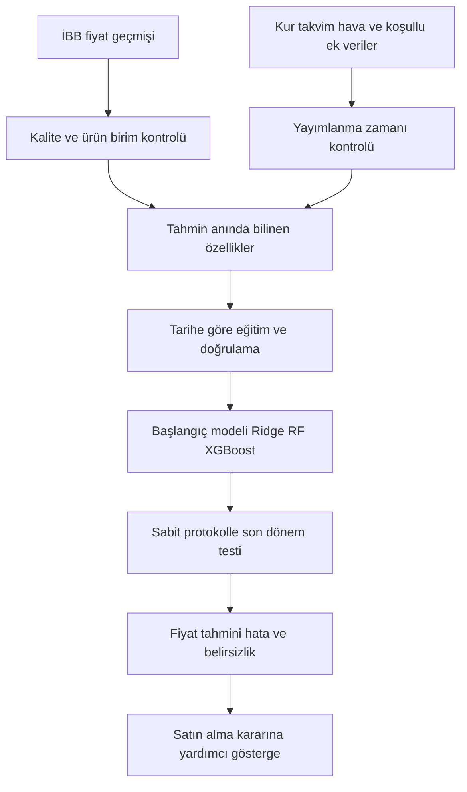

# İstanbul hal fiyat tahmini projesi için veri ve yöntem araştırması

Araştırma tarihi: 27 Ekim 2026. Kapsam: mevcut 2016–2026 İBB meyve-sebze verisini geliştirecek veri kaynakları, ilgili yayınlar, deney tasarımı ve satın alma karar desteği. Bu rapordaki uygulama önerileri araştırmadan çıkarılan proje tasarımıdır; henüz eğitilmiş model sonucu değildir.

## 1. Araştırmanın sonucu

Projenin yapılabilmesi için yeni bir büyük fiyat veri seti bulmak zorunlu değil. Mevcut İBB fiyat geçmişi temel deneyi kurmaya yeterli. En değerli gelişme, daha fazla algoritma eklemekten önce veri temizliğini ve tahmin anında bilgi erişilebilirliğini doğru kurmak olacaktır.

Önerilen sıra: fiyat geçmişi ve takvim → döviz kuru → üretim bölgelerinin gecikmeli hava verisi → erişimi ve eşleştirmesi doğrulanırsa HKS işlem hacmi → motorin ve yayımlanmış tarımsal endeksler. Her ek veri ayrı bir karşılaştırma deneyi olmalı. Fayda göstermeyen veri, teoride ilişkili olsa da final modelinden çıkarılabilir.

**Araştırma sorusu önerisi:** “İstanbul hal ürünlerinde geçmiş fiyat ve takvim özelliklerine kur, üretim bölgesi hava verisi ve işlem hacmi eklemek, bir sonraki kayıtlı veri gününün alt ve üst fiyat tahminini ne kadar iyileştiriyor?” Bu ifade hem makine öğrenmesi karşılaştırmasını hem veri katkısını ölçülebilir kılar.

Başlangıçta 5–10 ürün, ertesi veri günü ufku ve üç ana model yeterli: doğrusal regresyon/Ridge, Random Forest, XGBoost. İleri aşamada 5 veri günü ufku ve belirsizlik tahmini eklenebilir. Bir üründeki yaklaşık birkaç bin gün, yüz binlerce bağımsız zaman gözlemi değildir; panel satır sayısı ile seri uzunluğu ayrılmalıdır.

## 2. Mevcut veriye göre ön koşullar

Yerel `ibb_hal/inceleme/inceleme_ozeti.json` ve denetim raporu yeniden okunarak kapsam teyit edildi: 382.897 meyve-sebze kaydı; 255 kimlik; 2.674 veri günü; 04.01.2016–26.10.2026. Tam tekrar fazlalığı 1.761, sıfır fiyatlı satır 60, ters fiyat aralığı 91. İki masaüstü CSV birleştirilmemeli; meyve-sebze dosyası diğer dosyanın ilgili bölümüdür.

Ad değişikliği, birim değişikliği, uç fiyat ve sezon boşlukları çözülmeden ek veri çalışması nihai eğitim verisi sayılmamalıdır. Ürün kimliği + birim + hal türü temel seri anahtarıdır; ürün anlamı değiştiğinde dönem ayrımı gerekebilir. Bu araştırmada kaynak CSV'ler değiştirilmedi.

## 3. Veri kaynakları ve önceliklendirme

| Kaynak | Ne sağlar | Sıklık ve kapsam | Erişim durumu | Projedeki öncelik |
|---|---|---|---|---|
| İBB hal servisi | Alt/üst fiyat, ürün, kategori, birim kodu | Mevcut dosyada 2016–2026, kayıtlı günler | Katalog, lisans ve kategori servisi canlı kontrol edildi | Zorunlu temel |
| TCMB kur arşivi / EVDS | USD/TRY, EUR/TRY | İş günü; arşiv mevcut dönemi kapsıyor | Örnek XML başarıyla indirildi; EVDS API anahtar istiyor | İlk ek veri |
| Diyanet ve takvim | Ramazan, bayram, takvim etkileri | Günlük türetilebilir | Resmî dini gün listesi incelendi | İlk ek veri |
| Open-Meteo ERA5 | Sıcaklık, yağış ve diğer hava değişkenleri | Uzun tarihsel kapsam; günlük/saatlik | Antalya için 2016'da 7 günlük pilot başarılı | İlk genişletme |
| NASA POWER | Meteoroloji ve agroiklim değişkenleri | Günlük, 1981'den yakın zamana | Antalya için 7 günlük pilot başarılı | Hava verisine alternatif |
| HKS | Ortalama fiyat, işlem hacmi, ürün cinsi/türü, birim adı | Tarih seçilen günlük bülten | Güncel tablo görüldü; tam geçmiş dışa aktarımı denenmedi | Yüksek değerli, koşullu |
| EPDK | İl/marka/yakıt türüne göre bayi fiyatı | 01.01.2016'dan itibaren rapor bağlantısı | Resmî sorgu ekranı doğrulandı; dönem dosyası indirilmedi | İkinci genişletme |
| TÜİK Tarım-ÜFE / Tarım-GFE / TÜFE | Üretici, girdi ve genel fiyat koşulları | Aylık; yayımlama gecikmeli | Bülten ve metaveri incelendi | İkinci genişletme |
| TÜİK bitkisel üretim | İl/ürün üretimi, alan, verim | Yıllık ve yıl içi tahminler | Resmî kapsam ve yayın tarihi incelendi | Bölge seçimi ve arka plan |
| TEPGE ürün raporları | Üretim illeri, maliyet ve pazar bağlamı | Dönemsel rapor | Patates, soğan, turunçgil rapor bağlantıları incelendi | Alan bilgisi |
| Antalya Belediyesi | Başka halin fiyatları | Günlük ekran | Sayfa doğrulandı; 2016–2026 arşivi doğrulanmadı | İleri aşama |
| FAO / Dünya Bankası | Küresel gıda, enerji, gübre endeksleri | Çoğunlukla aylık | Resmî indirme sayfaları incelendi | Düşük öncelikli deney |

“Ekran görüldü” ile “tam dönem veri indirildi” aynı değildir. Hiçbir koşullu kaynak projenin bitirilebilmesi için zorunlu bağımlılık yapılmamalıdır.

### 3.1 İBB ana kaynak ve birim sözlüğü

[İBB veri kataloğu](https://data.ibb.gov.tr/tr/dataset/hal-urunleri-ve-fiyatlari-web-servisi), meyve-sebze hali verisini ve [Swagger bağlantısını](https://halfiyatlaripublicdata.ibb.gov.tr/swagger/ui/index) yayımlıyor. Katalogdaki son güncelleme tarihi 2022; bu, servisteki fiyatların 2022'de bittiği anlamına gelmiyor. Kategori servisi canlı istekte 5=Meyve, 6=Sebze, 7=İthal Ürünler eşleşmesini döndürdü.

[İBB açık veri lisansı](https://data.ibb.gov.tr/license), kaynak göstererek yeniden kullanımı destekliyor. Raporda veri sağlayıcısı, kaynak URL'si, erişim tarihi ve lisans bağlantısı tutulmalı. Lisansın bütün üçüncü taraf veri kaynaklarına da geçerli olduğu varsayılmamalı.

Önemli açık iş: katalog birim türleri servisini de tarif ediyor; ancak Swagger arayüzü açılmasına rağmen içindeki belge isteği bu oturumda bağlantı kapanmasıyla sonuçlandı. **Birim kodlarının adları henüz doğrulanmadı.** Tahmin çıktısına “TL/kg” yazmadan önce resmi birim sözlüğü alınmalı. HKS'deki “Kg” alanı, İBB kodlarının otomatik karşılığı olarak kullanılamaz.

### 3.2 TCMB döviz kuru

[TCMB kur açıklamasına](https://www.tcmb.gov.tr/wps/wcm/connect/TR/TCMB%2BTR/Main%2BMenu/Temel%2BFaaliyetler/Doviz%2BEfektif/Doviz%2Bve%2BEfektif%2BPiyasalari/Gosterge%2BNiteligindeki%2BKurlar) göre gösterge kurlar iş günlerinde 15.30'da ilan edilir; hafta sonları, resmî tatiller ve yarım günlerde yeni gösterge kur belirlenmez. [05.10.2026 tarihli XML](https://www.tcmb.gov.tr/kurlar/202610/05102026.xml) pilotta HTTP 200 döndürdü; USD/EUR alış-satış ve birim alanları okunabildi.

Önerilen özellikler: mevcut erişilebilir kur, 1/5/20 iş günlük değişim, 5/20 gözlemlik oynaklık. Artışın fiyatı hangi gecikmeyle etkilediği deneyle ölçülmeli; nedensellik iddiası yapılmamalı. Aynı gün sabah tahmini yapılıyorsa o günün 15.30 kuru kullanılamaz. En son yayımlanmış kur ileri taşınabilir, gelecekteki kurla geriye doldurma yapılamaz.

[Resmî EVDS Python kılavuzu](https://evds2.tcmb.gov.tr/help/videos/EVDS_PYTHON_Kullanim_Kilavuzu.pdf) hesap/API anahtarı gerektiriyor ve anahtarın HTTP başlığında gönderilmesini belirtiyor. Örnek seri adları dokümanda bulunuyor; seçilen seri kodu ve zaman damgasının anlamı uygulama sırasında ayrıca doğrulanmalı. XML arşivi ilk kur deneyi için anahtar gerektirmeyen bir alternatif olarak pilotta çalıştı. EVDS'den bütün dönem çekilmedi.

### 3.3 Takvim ve talep dönemleri

[Diyanet'in 2026 dini günler listesi](https://vakithesaplama.diyanet.gov.tr/icerik.php?icerik=153), Ramazan ve dini bayramlar için resmî kaynak adayıdır; sitede diğer yılların listeleri de bulunur. 2016–2026 için yıllar ayrı doğrulanmalı. Ulusal bayramlar ile dini günler aynı değişken sayılmamalı; halin fiilen açık olduğu günler ayrıca gözlenmeli.

Türetilecek özellikler: ay, haftanın günü, yılın günü için sinüs/kosinüs, Ramazan içinde olma, bayrama kalan gün, bayramdan geçen gün, hafta sonuna uzaklık ve önceki fiyat kaydından geçen takvim günü. Tatil takvimi gelecekte bilinebilen bir özelliktir; fakat günlük kayıt yokluğunu sadece tatille açıklamak doğru değildir.

### 3.4 Open-Meteo hava verisi

[Historical Weather API](https://open-meteo.com/en/docs/historical-weather-api), ERA5 için 1940'tan itibaren veri ve yaklaşık beş günlük yayın gecikmesi açıklıyor. İstasyon ölçümüyle birebir aynı veri değildir. Aynı model seçilerek dönem tutarlılığı korunmalı. Antalya merkezini temsil eden 36.89/30.70 koordinatında 04–10.01.2016 için dört günlük değişkenin 7 satırı pilotta başarıyla alındı; bu tek nokta bütün Antalya üretimini temsil etmez.

Başlangıç özellikleri: gecikmeli sıcaklık ortalaması, minimum sıcaklık, yağış toplamı; 7/14/30 günlük geçmiş özetleri. Don göstergesi olarak minimum sıcaklığın 0°C altında olması denenebilir; ürün bazında gerçek zarar eşiği olarak sunulmamalıdır. Yayımlanma gecikmesi yüzünden t gününde t gününün kesinleşmiş ERA5 verisini kullanmak gerçek zamanlı deney değildir. Muhafazakâr gecikme ve veri sürümü kaydı gerekir; bugün indirilen revize arşiv ile o gün bilinen veri ayrımı raporlanmalıdır.

[Kullanım koşulları](https://open-meteo.com/en/terms) ücretsiz API'yi ticari olmayan kullanıma açıyor; günlük 10.000'den az, saatlik 5.000 ve dakikalık 600 çağrı sınırlarını ve CC BY 4.0 atfını belirtiyor. Ders projesi ölçeğinde az sayıda bölgeyi dönem bloklarıyla çekmek ve önbelleğe almak uygun tasarımdır. Uzun sorguların maliyeti ve güncel plan koşulları toplu indirmeden önce yeniden kontrol edilmelidir.

Yarının hava bilgisini eklemek istenirse gerçekleşmiş yarın havası kullanılamaz. [Historical Forecast API](https://open-meteo.com/en/docs/historical-forecast-api) ile [Previous Runs API](https://open-meteo.com/en/docs/previous-runs-api) farklı ürünlerdir. İlk saatleri birleştirilmiş arşiv, “bir gün önce yayımlanan yarın tahmini” ile aynı şey değildir. Geçmiş koşumların kapsamı model ve öncü süreye göre sınırlıdır; tekil koşumun yayımlanma zamanı tahmin kararından önce olmalıdır. Bu ileri deney için daha kısa bir ortak tarih aralığı gerekebilir.

### 3.5 Hangi bölgenin havası kullanılmalı

İstanbul havası tüketim/ulaşım koşullarını temsil edebilir. Üretim şokları için üretim bölgeleri daha anlamlı bir hipotezdir. Domates için Antalya, Mersin gibi yerler ilk araştırma adayı olabilir; bunların İstanbul'a gerçek sevkiyat payı bu dosyalarda yoktur.

[TÜİK bitkisel üretim metaverisi](https://veriportali.tuik.gov.tr/Bulten/Index?p=Bitkisel-Uretim-Istatistikleri-2025-53939), üretim/alan/verim istatistiklerini ve 1991'den itibaren yıllık kapsamı açıklıyor. En son rapordaki üretim paylarını bütün geçmişe uygulamak geleceğe bakma riski taşır. Bölge seçimini eğitim döneminde yayımlanmış üretim bilgisiyle sabitlemek veya her yıl yalnızca o tarihte yayımlanmış paylarla güncellemek gerekir.

Önerilen temsil: ürün başına 2–3 bölgenin havasını ayrı sütunlarda denemek; daha sonra erişilebilir üretim paylarıyla ağırlıklandırmak. Üretim payı, İstanbul'a sevkiyat payı değildir. Tek şehir merkezi koordinatı yerine birden çok üretim noktası ancak veri ve süre uygunsa kullanılmalı.

### 3.6 NASA POWER ve MGM alternatifleri

[NASA POWER günlük API dokümanı](https://power.larc.nasa.gov/docs/services/api/temporal/daily/), 1981'den yakın zamana günlük veriyi, JSON/CSV çıktılarını ve UTC/LST seçeneklerini açıklıyor. Pilot: T2M, T2M_MIN, T2M_MAX ve PRECTOTCORR için 7 günlük yanıt alındı. Yanıttaki eksik veri işareti -999; bunu gerçek sıcaklık/yağış gibi kullanmamak gerekir. UTC günlük toplamı ile Türkiye yerel gününün toplamı birebir aynı zaman aralığı değildir.

NASA'yı Open-Meteo'ya alternatif bir hava kaynağı olarak düşünmek daha temiz bir ilk deneydir. Aynı fiziksel sinyalin iki kaynaktan çok sayıda kopyasını eklemek yerine kaynak duyarlılığı ölçülebilir. NASA arşivinin tarihsel yayımlanma gecikmesi bu araştırmada doğrulanmadı; canlı kullanıma uygunluk ayrıca kontrol edilmelidir.

[MGM bilgi edinme sayfası](https://www.mgm.gov.tr/site/bilgi-edinme.aspx?r=a), sitede yayımlananlar dışındaki meteorolojik veri taleplerinin ücretli olabileceğini belirtiyor. MEVBİS erişimi, akademik koşullar ve istasyon dönemleri önceden kesin varsayılmamalı. Dersin yapılabilirliğini ücretli/başvuru bekleyen veriye bağlamayın.

### 3.7 HKS işlem hacmi ve ortalama fiyat

[Ticaret Bakanlığı HKS fiyat detayları](https://www.hal.gov.tr/Sayfalar/1_FiyatDetaylari.aspx) ekranında ürün adı, cinsi, türü, ortalama fiyat, işlem hacmi ve birim adı görüldü. İncelenen bülten başlığı, 26.10.2026 tarihli bültende 25.10.2026 verilerinin kullanıldığını açıkça söylüyor. Veri tarihi ile yayımlama tarihi ayrılmalıdır; aynı günlük gözlem sanki aynı anda biliniyormuş gibi eklenmemeli.

Önerilen özellikler: son yayımlanmış işlem hacmi, 5/20 günlük hacim özeti, hacim değişimi, HKS ortalama fiyatının gecikmeli değişimi. Ekranın ulusal/rapor kapsamı ayrıca teyit edilmeli; görülen hacim “İstanbul haline gelen miktar” diye etiketlenmemeli. Hacim, işletmenin müşteri talebi de değildir.

Ürün cinsi, konvansiyonel/organik türü ve birim uyumlu olmalı. İBB çeşitleri ile HKS adları için elle denetlenebilir eşleme tablosu gerekir. Tarihsel tam arşiv, yeniden kullanım şartları ve dışa aktarımın kapsamı bu araştırmada indirme düzeyinde doğrulanmadı. Önce seçilen ürünlerde 30 günlük küçük örnekle tarih/birim/ürün eşleşmesi sınanmalı; erişim yoksa HKS'siz deney tamamlanabilir.

### 3.8 EPDK motorin

[EPDK resmî rapor sayfası](https://www.epdk.gov.tr/Detay/Icerik/3-0-0-1205/illere-gore-akaryakit-bayi-fiyatlari-raporu), 01.01.2016'dan başlayan il bazlı rapor bağlantısı veriyor. [Sorgu ekranında](https://bildirim.epdk.gov.tr/bildirim-portal/faces/pages/tarife/petrol/illereGorePetrolAkaryakitFiyatSorgula.xhtml) tarih, marka, bölge ve yakıt türü seçimi ile indirme seçeneği bulunuyor. Ekranın seçim yapılmadan “kayıt bulunamadı” demesi veri olmadığına kanıt değildir.

Öneri: aynı motorin türünü, aynı bölge ve tutarlı marka örneklemiyle izlemek. İstanbul Anadolu/Avrupa ayrı seçimlerdir. Markalar arası basit ortalama, satış ağırlıklı ortalama olarak adlandırılmamalıdır. Fiyat seviyesi, değişim ve son güncellemeden geçen süre denenebilir. Taşıma mesafesi ve sevkiyat ağırlığı yokken gerçek lojistik maliyet hesaplanmış sayılmaz. Dosya indirme ve tüm dönem kapsaması henüz test edilmedi.

### 3.9 TÜİK fiyat endeksleri

[Tarım-GFE metaverisi](https://veriportali.tuik.gov.tr/tr/press/54024) 2015'ten başlayan aylık kapsamı açıklıyor. [Tarım-ÜFE Eylül 2026 bülteni](https://veriportali.tuik.gov.tr/tr/press/57972/metadata) ise 14.10.2026 saat 10.00'da yayımlanmış. Dolayısıyla Eylül değerini 1 Eylül'den itibaren her güne yazmak mümkün değildir. Günlük satıra son yayımlanmış değer eklenmelidir. Endeksin bir ayı ile yayım gününü ayıran tablo tutulmalı.

[TÜFE Ocak 2026 bülteni](https://veriportali.tuik.gov.tr/Bulten/Index?dil=1&p=T%C3%BCketici-Fiyat-Endeksi-Ocak-2026-58293), 2025=100 bazını kullanıyor. Farklı baz yıllı eski ve yeni endeks değerleri doğrudan yapıştırılmamalı; yayımlanan tutarlı seri veya belgelenmiş bağlama kullanılmalı. Aynı ayın henüz yayımlanmamış endeksiyle fiyatı reel hale getirip tahmin özelliği üretmek de sızıntıdır.

Girdi endeksi, üretici endeksi ve gıda TÜFE alt endeksi ayrı deney bloklarıdır. Günlük ufukta yavaş değişen bu değişkenlerin katkısı sınırlı olabilir; bu bir araştırma hipotezidir. Sonradan düzeltilmiş tarihsel seriler kullanılırsa revizyon sınırlılığı belirtilmeli. Serilerin ücretsiz görülebilmesi, ham verinin topluca yeniden dağıtım hakkını otomatik kanıtlamaz; nihai veri paketi için ilgili koşullar kontrol edilmeli.

### 3.10 İkinci plandaki kaynaklar

[TEPGE ürün raporları](https://arastirma.tarimorman.gov.tr/tepge/Menu/37/) üretim bölgesi ve maliyet mekanizmasını anlamada yararlı. İncelenen Patates 2025 raporunda il üretimi tabloları bulunuyor ve yayın bilgisi Kasım 2025. Rapordaki bilgileri daha eski bir tahmin anında biliniyor saymamak gerekir. Tam PDF'leri yeniden paketlemek yerine kaynağa bağlantı verilmeli; birincil tablo kaynakları tercih edilmeli.

[Antalya günlük hal fiyatları](https://antalya.bel.tr/BilgiEdin/halden-gunluk-fiyatlar), bölgesel fiyat yayılımını incelemek için aday. On yıllık arşiv, toplu indirme, ürün eşdeğerliği ve yayımlama saatleri doğrulanmadan İstanbul modeli için hazır veri kabul edilemez.

[FAO gıda fiyat endeksi](https://www.fao.org/worldfoodsituation/FoodPricesIndex/en/) aylık küresel gıda sepetidir ve 1990'dan itibaren aylık indirme bağlantıları sunar; İstanbul domates fiyatı değildir. [Dünya Bankası Pink Sheet](https://www.worldbank.org/en/research/commodity-markets) aylık enerji/gübre gibi dış maliyet göstergeleri için adaydır. İkisi de son yayımlanmış değerleriyle denenebilir; günlük modelin zorunlu parçası yapılmamalıdır. FAOSTAT ise üretim bağlamı için aday; bu oturumda dinamik veri tablosu okunamadığı için spesifik dosya kapsamı doğrulanmış sayılmadı.

## 4. Akademik yayınlar ve projeye aktarılabilecek dersler

### A. En yakın Türkiye örneği

**Bulut, M. (2025). Forecasting prices of salad vegetables using statistical and artificial intelligence techniques. Ciência Rural, 55(11), e20240444.** [Tam metin ve DOI](https://www.scielo.br/j/cr/a/WZs4CVKzPLzSkwbHDKsj5zd/?lang=en), DOI: 10.1590/0103-8478cr20240444.

HKS kaynaklı maydanoz, limon, karnabahar ve havuç fiyat/hacimleriyle CNN, LSTM ve RF karşılaştırıyor. Bizim için asıl katkısı, hacim verisi ve çok değişkenli tahmin örneği olması. Ancak özetteki dönem ile yöntem/sonuç bölümündeki tarihler farklı; dört ürün anlatımıyla bazı çıktı ifadeleri de uyuşmuyor. Ölçekleme, fark alma ve test hatalarının hangi ölçekte verildiği dikkatle incelenmeli. Modeli kopyalamak veya CNN'nin bizim veride de kazanacağını varsaymak doğru değil. Ayrı indirilebilir ham veri dosyası bu incelemede doğrulanmadı.

### B. Türkiye domatesinde mevsimsellik

**Adanacıoğlu, H. ve Yercan, M. (2012). An analysis of tomato prices at wholesale level in Turkey: an application of SARIMA model. Custos e @gronegócio on line, 8(4), 52–75.** [Yayıncı PDF'si](https://www.custoseagronegocioonline.com.br/numero4v8/Tomato%20english.pdf).

Antalya'nın 2000–2010 aylık domates fiyatlarında SARIMA uyguluyor. Mevsimsellik ve istatistiksel karşılaştırma için doğrudan ilgili. Aylık sonuçları günlük ufka taşımayın; 12 aylık mevsim dönemi, düzensiz günlük veride 12 satır demek değildir. Eski dönem ve başka pazar olduğu için doğruluk sayıları bizim deneyin hedefi olarak kullanılamaz.

### C. Tarımsal emtialarda optimize edilmiş modeller

**Sari, M., Duran, S., Kutlu, H., Guloglu, B. ve Atik, Z. (2024). Various optimized machine learning techniques to predict agricultural commodity prices. Neural Computing and Applications, 36, 11439–11459.** [Açık erişim yayıncı sayfası](https://link.springer.com/article/10.1007/s00521-024-09679-x), DOI: 10.1007/s00521-024-09679-x.

ARIMA, genetik algoritmayla optimize edilen ELM ve LSTM ailesini 11 emtiada karşılaştırıyor. Çok ürünlü değerlendirme ve optimizasyonun ayrı raporlanması açısından ilgili. Veri erişim beyanı yazardan makul talep üzerine erişim diyor; hazır indirilebilir veri diye sunulmamalı. Genetik algoritma dersin ilk sürümü için gerekli değil.

### D. Ek veri her zaman kazanç sağlamaz

**Vairo, A., Romano, F. ve Grilli, L. (2026). Assessing the role of weather in commodity price forecasting: evidence from fine durum wheat. Computational Management Science, 23, 26.** [Açık erişim makale](https://link.springer.com/article/10.1007/s10287-026-00576-3), DOI: 10.1007/s10287-026-00576-3; yayın tarihi 10.07.2026.

Aylık makarnalık buğdayda hava özellikli/özelliksiz XGBoost ve LSTM karşılaştırması, havanın tutarlı fayda sağlamadığını bildiriyor. Bizde de “hava ekledik” yerine katkı deneyi yapmak için gerekçe. Günlük taze ürüne doğrudan genellenemez. Metin, model seçimini doğrulama ve test performansıyla ilişkilendiriyor; bizim protokolde nihai test ayarlama için kullanılmamalı. Bu makale yöntemlerin koşulsuz doğruluğuna kanıt olarak alınmamalıdır.

### E. Güncel alan taraması

**Wu, B., Wang, J., Li, Q., Fu, D. ve Wang, L. (2026). A Comprehensive Review for Agricultural Product Prices Forecasting: Architectural Diversity and Open Challenges. Expert Systems, 43(5), e70254.** [Yayıncı sayfası](https://onlinelibrary.wiley.com/doi/10.1111/exsy.70254), DOI: 10.1111/exsy.70254.

2006–2025 arasındaki 773 çalışmayı ele alan tarama; girdi/çıktı tasarımı, yöntem aileleri, belirsizlik ve sızıntı sorunlarını çerçeveliyor. Bu oturumdaki güvenilir erişim yayın bilgisi ve özet düzeyindedir; tam metin sistematik olarak okunmuş gibi kullanılmamalı. Literatür bölümünü düzenlemek ve kaynak zincirini genişletmek için uygun.

### F. Türkiye ekonomik göstergeleri

**Şenel, U. T., Arıcı, N., Narin, M. ve Polat, H. (2026). From Feature Selection to Forecasting: A Two-Stage Hybrid Framework for Food Price Prediction Using Economic Indicators in Türkiye. Sustainability, 18(1), 503.** [Yayıncı bağlantısı](https://www.mdpi.com/2071-1050/18/1/503), DOI: 10.3390/su18010503.

Türkiye'de ekonomik göstergeler ve gıda fiyatları ilişkisini ele alan ilgili aday. Arama dizininde yayıncı metni görüldü ancak doğrudan tam metin isteği 429 ile sınırlandı. Bu nedenle yöntem denetimi yapılmış temel kaynak yerine tamamlayıcı okuma olarak listeleniyor. Başarı sayıları bizim projeye aktarılmadı.

### G. Ağaç modelleri neden ilk sırada

**Grinsztajn, L., Oyallon, E. ve Varoquaux, G. (2022). Why do tree-based models still outperform deep learning on typical tabular data? NeurIPS Datasets and Benchmarks.** [Resmî konferans sayfası](https://proceedings.neurips.cc/paper_files/paper/2022/hash/0378c7692da36807bdec87ab043cdadc-Abstract-Datasets_and_Benchmarks.html).

45 tablosal veri setindeki karşılaştırma, orta boy tablosal veride ağaç yöntemlerinin güçlü olduğunu gösteriyor. Özellik üretilmiş fiyat tablosunda RF/XGBoost ile başlamayı destekler. Tarımsal zaman serilerinin özel testi değildir; LSTM veya Transformer'ın kesinlikle kötü olduğu sonucu çıkarılamaz.

### H. Ürün başına mı ortak model mi

**Montero-Manso, P. ve Hyndman, R. J. (2020; gözden geçirilmiş sürüm 2021). Principles and Algorithms for Forecasting Groups of Time Series: Locality and Globality.** [Yazarların arXiv metni](https://arxiv.org/abs/2008.00444).

Yerel ve global tahmin yaklaşımlarını teorik/ampirik olarak tartışıyor. Önce her ürün için ayrı modeli, sonra ürün kimliği ve geçmiş fiyat özellikleri kullanan ortak modeli karşılaştırmak için gerekçe sunar. Ortak modelde bütün ürünler aynı tarih sınırlarıyla ayrılmalı; aynı tarihte bazı ürünler eğitimde bazıları testte kalmamalıdır.

### I. Tahmin belirsizliği

**Xu, C. ve Xie, Y. (2021). Conformal prediction interval for dynamic time-series. ICML, PMLR 139, 11559–11569.** [Resmî bildiri sayfası](https://proceedings.mlr.press/v139/xu21h.html).

Zaman serileri için EnbPI yaklaşımı, ileri aşamada kalibre edilen aralık tahminine kaynak olabilir. Bağımlı veride standart değiştirilebilirlik varsayımı otomatik sağlanmaz; teorik sonuçların koşulları vardır. Dersin ilk sürümünde zorunlu değil. Önce basit quantile tahmini ve gerçek dönem kapsamı ölçülmeli.

### J. Uygulama kaynakları

[Forecasting Principles and Practice](https://otexts.com/fpp3/toolbox.html) başlangıç tahminleri, hata ölçüleri ve zaman sıralı değerlendirme için açık ders kaynağıdır. [scikit-learn gecikmeli özellik örneği](https://scikit-learn.org/stable/auto_examples/applications/plot_time_series_lagged_features.html) rastgele bölmenin iyimser sonuç verebildiğini uygulamayla gösterir. [TimeSeriesSplit dokümanı](https://scikit-learn.org/stable/modules/generated/sklearn.model_selection.TimeSeriesSplit.html) eş süreli bölümleri karşılaştırmak için eşit aralıklı gözlem varsayımını belirtir. Bizim düzensiz panelde tarih tabanlı özel bölmeler daha açık olacaktır.

## 5. Birleştirme tasarımı ve bilgi sızıntısı

Her ek veri için şu alanlar tutulmalı: `observation_date`, `published_at`, `retrieved_at`, `source`, `series_id`, `unit`, `value`, varsa `revision`. Tahmin satırında `forecast_origin`, `target_date`, `product_id`, `unit_id` olmalı. Yalnızca `published_at <= forecast_origin` olan kayıtlar özelliğe dönüşebilir. Eski tarihli bir veriyi bugün indirmiş olmak, o günkü ilk yayımlanma değerini bildiğimizi göstermez.

Pandas'ta [merge_asof yönü backward](https://pandas.pydata.org/docs/reference/api/pandas.merge_asof.html), önceki/en son anahtar eşleşmesini destekler. Birleştirme anahtarı veri ayı değil yayımlama zamanı olmalı; girdiler zaman anahtarına göre sıralanmalı. Seri kimliği ve birim kontrolü ayrıca yapılmalı. Aşırı eski değerin sonsuza dek taşınmaması için tolerans ve `veri_yasi` alanı gerekir. Bu fonksiyon yanlış yayın zamanını kendiliğinden düzeltmez.

Örnek: 10.10.2026'da Eylül Tarım-ÜFE'si henüz 14 Ekim'de yayımlanacaksa kullanılamaz. Sabaha ait tahminde aynı gün 15.30 kuru yoktur. ERA5'in arşivden bulunan yarın sıcaklığı da yoktur. HKS'nin bülten tarihini bir gün geriye taşıyıp o gün biliniyormuş gibi kullanmak yanlıştır.

Tahmin anı için ilk varsayım: t gününün İBB fiyatları yayımlandıktan sonra, bir sonraki kayıtlı veri gününü tahmin etmek. Operasyonel saat henüz doğrulanmadığından canlı sistemin ilan saati kesinleştirilmelidir. Sabah satın alma anına geçilecekse özellikler buna göre geriden gelmeli.

## 6. Özellikler ve hedefler

| Blok | İlk denenecek özellikler | Kontrol |
|---|---|---|
| Fiyat | Mevcut alt/üst, 1/2/5/10/20 önceki gözlem | Seri sınırından taşmama |
| Hareket | 5/10/20 geçmiş ortalama, sapma, min/max | Merkezlenmiş pencere kullanmama |
| Değişim | Fark, log oran, aralık genişliği | Sıfır/ters fiyat önce çözülmeli |
| Takvim | Ay, hafta günü, dönemsel sin/cos, bayram | Takvim günü ve veri günü ayrımı |
| Kur | Son yayımlanmış seviye ve geçmiş değişimler | İlan saatinden önce kullanmama |
| Hava | Yayımlanmış geçmiş sıcaklık/yağış özetleri | Kaynak/model gecikmesi |
| Hacim | Son yayımlanmış hacim ve geçmiş özeti | HKS kapsamı/birim eşleşmesi |
| Endeks | Son yayımlanmış endeks ve yaş/değişim | Dönem ve yayın tarihi ayrımı |

Hedefler: `y_min(t+1)` ve `y_max(t+1)`. İlk sürümde iki ayrı regresyon en anlaşılır yaklaşımdır. Hem bugünün fiyatı hem geçmişi kullanılabilir; ancak verinin satır gösterimi t hedefini taşıyorsa lag tanımı buna göre açık yazılmalıdır. Teknik reçetede her yerde körlemesine `shift(1)` uygulamak yerine “tahmin anında bilinen en son fiyat hangisi?” sorusu esas olmalıdır.

Fiyat seviyesini tahmin etmenin yanında değişim veya log değişim hedefi karşılaştırılabilir. Geçmiş seviyelerin dışına çıkma ve enflasyon etkisi bu şekilde incelenebilir; geri dönüşüm ve hata hesabı özgün fiyat ölçeğinde yapılmalı. Sadece normalleştirilmiş hedefte küçük hata gösterilmemeli.

Alt-üst tutarlılığı için aday tasarım: pozitif alt fiyatın logunu ve sıfırdan küçük olmayan aralığın `log1p(max-min)` değerini öğrenmek; geri dönüşte üst=alt+aralık kurmak. Bu, orijinal iki hedefi ayrı öğrenmekten farklı hata davranışı yaratır; hangi yöntemin kullanılacağı doğrulamada seçilmeli. Sıralama düzeltmesi uygulanırsa ham ve düzeltilmiş sonuç ayrı ölçülmeli.

## 7. Deney matrisi ve yöntem seçimi

| Deney | Veri | Amaç |
|---|---|---|
| B0 | Bugünün fiyatını taşı | Yenilmesi gereken güçlü referans |
| B1 | Geçmiş ortalama / uygun haftalık benzer gün | İkinci basit referans |
| M1 | Fiyat + takvim | Ana ML karşılaştırması |
| M2 | M1 + kur | Kurun ek katkısı |
| M3 | M1 + hava | Havanın ek katkısı |
| M4 | M1 + HKS hacmi | Hacmin ek katkısı; veri erişimi koşullu |
| M5 | M1 + motorin/endeks | Yavaş maliyet göstergeleri |
| M6 | Doğrulamada faydalı bloklar | Birleşik final aday |

Bütün modeller ortak hedef satırlarında karşılaştırılmalı. HKS sadece kısa dönemde varsa önce fiyat modeli o kısa ortak dönemde de çalıştırılmalı; bir modelin daha kolay dönemde test edilmesi “ek veri kazancı” sayılmaz. Eksik değerlerin korunması/imputasyonu eğitimde öğrenilmeli, eksiklik göstergeleri tutulmalı.

Önerilen modeller: doğrusal regresyon ve gerekirse Ridge; RF; XGBoost. SARIMA/SARIMAX bir veya iki ürün için istatistiksel ek karşılaştırma olabilir. Düzensiz günlük seriye otomatik 365 satırlık sezon dayatılmamalı. LSTM/CNN en sonda aynı veri ve aynı testle denenebilir. Transformer, VMD/EMD ve genetik arama ilk teslimin gerekli parçası değildir. Tüm seriyi önce ayrıştırıp sonra bölmek gelecekteki gözlemleri geçmiş bileşenlere sızdırabilir.

Başlangıç araması için öneri, kanıtlanmış en iyi değerler değil: RF derinlik {5,10,None}, yaprak alt sınırı {5,20}; XGBoost derinlik {2,4,6}, öğrenme oranı {0.03,0.1}; Ridge alfa {0.1,1,10}. Ağaç sayısı ve erken durdurma yalnızca doğrulamayla seçilmeli. Her modele makul ve karşılaştırılabilir arama bütçesi verilmeli. Üç sabit rastgele tohumla duyarlılık kontrolü yararlı olabilir.

Yerel modeller açıklamayı kolaylaştırır. İkinci deneyde ortak modele ürün bilgisi eklenerek veri paylaşımı sınanabilir. Ürün kimliği zamanla değişiyorsa eski-yeni eşlemeyi eğitim bilgisi dışında öğrenmemek gerekir. Yeni ürünlere genelleme iddiası varsa ayrıca görülmemiş ürün testi gerekir.

## 8. Zaman sıralı değerlendirme ve başarı ölçütleri

Mevcut önerideki son 12 aylık test korunarak tasarım: eğitim hedef tarihleri 26.10.2024 ve öncesi; doğrulama 27.10.2024–26.10.2025; final test 27.10.2025–26.10.2026. Eğitim/özellik seçiminde mümkünse 2024 öncesi birkaç ilerleyen tarih bölmesi kullanılmalı. Bunlar veri günü garantisi olmayan takvim sınırlarıdır.

Panelde ayrım ürün satır sayısına göre değil, ortak hedef tarihine göre yapılmalı. Çok ufuklu hedefler eklenirse eğitim örneğinin son hedefi karar anını aşmamalı; sınır örnekleri buna göre temizlenmeli. Bölmeler arasında pencere çakışması tek başına sızıntı değildir; gelecekteki hedeflerin eğitimde kullanılması sızıntıdır.

Final testte sabit eğitimli model mi, geçmiş sonuçlar geldikçe aylık yeniden eğitilen model mi kullanılacağı önceden sabitlenmeli. İkisi farklı deneydir. İlerleyen testte geçmiş test günlerinin artık bilinen etiketleriyle güncelleme yapılabilir; gelecekteki günler kullanılamaz ve hiperparametreler test sonucuna göre değiştirilmemelidir.

Önceki veri denetiminde son dönemin fiyat değişmeme oranı ve başlangıç hataları incelendi. Dolayısıyla bu bölüm tamamen hiç görülmemiş veri diye sunulmamalı. Bundan sonra protokol sabitlenmeli; ileride toplanacak veriler bağımsız ileri tarihli kontrol olabilir. Araştırma sırasında mevcut nihai testte model seçimi yapılmadı.

Ana ölçütler: ürün/hedef bazında MAE ve RMSE; başlangıca göre `1 - MAE_model/MAE_baslangic` kazancı; ürünlerin eşit ağırlıklı özeti ve dönemsel hata dağılımı. Başlangıç MAE sıfırsa oran tanımsız olarak işaretlenmeli. R² yardımcı; MAPE sıfır/küçük fiyatlarda sorunlu; MASE kullanılacaksa ölçek paydası yalnızca eğitimden hesaplanmalı. Farklı birimlerdeki ham hatalar tek TL/kg gibi birleştirilmemeli.

Değişmedi günlerinin çokluğu nedeniyle yön başarısı artış/azalış/değişmedi sınıfları ve karışıklık tablosuyla ayrıca raporlanmalı. Küçük değişim eşiği eğitim/doğrulamada belirlenmeli. Bir günlük hareketlerde yüksek R², satın alma kararının iyi olduğunu tek başına göstermez. Zaman bağımlılığına saygılı tarih bloklarıyla hata farklarının belirsizliği incelenebilir; iid satır bootstrap'ı ortak tarih şoklarını bozabilir.

## 9. Açıklanabilirlik ve belirsizlik

Önce veri bloklarını çıkararak katkı ölçmek, sonra özellik önemi göstermek daha ikna edicidir. [scikit-learn korelasyonlu özellik örneği](https://scikit-learn.org/stable/auto_examples/inspection/plot_permutation_importance_multicollinear.html), benzer değişkenlerin tekil permütasyon önemini gizleyebileceğini gösteriyor. Yakın fiyat laglarını grup olarak değerlendirmek; SHAP varsa nedensellik kanıtı gibi yorumlamamak gerekir.

[XGBoost resmî quantile örneği](https://xgboost.readthedocs.io/en/release_2.1.0/python/examples/quantile_regression.html), `reg:quantileerror` ile farklı quantile'ları tahmin etmeyi gösteriyor. Uygulamada sürüm desteği doğrulanmalı. Örnekte “Test” adlı durdurma verisini kendi nihai testimiz olarak kullanmak yerine ayrı doğrulama verilmelidir.

Öneri: bir hedef için yüzde 10/50/90 tahminleri; ampirik kapsama ve ortalama aralık genişliği; pinball kaybı. Quantile kesişmesi kontrol edilmeli. “Yüzde 80 aralık” adı, gerçek veride kapsama ölçülmeden garanti anlamına gelmez. Alt fiyat ve üst fiyat hedefleri iki ayrı belirsizliğe sahiptir; her biri için marjinal aralıkların birlikte kapsaması farklıdır.

**İBB minimum–maksimum fiyat aralığı, modelin belirsizlik aralığı değildir.** Bu ayrım sunumda mutlaka belirtilmeli.

## 10. Satın alma planlaması nasıl geliştirilebilir

Mevcut veriyle savunulabilir çıktı: mevcut alt/üst fiyat, ertesi gün tahmini, beklenen değişim, geçmiş hata ve varsa kalibre edilmiş tahmin aralığı. Beklenen fark model hatasına göre çok küçükse “belirgin sinyal yok” gösterilebilir. Sinyal eşiği doğrulamada belirlenmeli.

Gerçek bir satın alma modeli için işletmeden ayrıca gerekli veriler: tarih/ürün/birim bazında satın alınan miktar ve fatura birim fiyatı; günlük tüketim/satış; eldeki stok ve stok yaşı; fire/bozulma; depolama maliyeti ve kapasitesi; teslim süresi; minimum sipariş; stokta yok maliyeti ve sipariş masrafı. Müşteri/personel kimlikleri bu amaç için gerekli değildir. HKS hacmi bu işletme değişkenlerinin yerine geçmez.

İşletme verisi bulunmazsa varsayımsal senaryo açıkça simülasyon olarak etiketlenebilir. Örneğin yarının sabit ihtiyaç miktarını bugün almak ile yarın almak karşılaştırılır. Bugün alınan ürünün fire oranı s ise yarın q kullanılabilir birim için yaklaşık q/(1-s) alınması gerekir; maliyete depolama, teslimat ve kısıtlar eklenir. Hal alt/üst fiyatı gerçek fatura bedeli olmadığından sonuç “gerçekleşmiş işletme tasarrufu” değildir.

Karşılaştırılacak kurallar: her gün ihtiyaç kadar al, sabit güvenlik stoğu, model destekli ön alım. Geriye dönük simülasyonda bütün kurallar aynı talep, maliyet ve stok şartlarıyla ilerlemeli; gelecekteki fiyatı gören kural ancak erişilemez bir üst sınır olarak etiketlenebilir. Daha iyi fiyat MAE'si daha düşük toplam işletme maliyetini otomatik sağlamaz.

## 11. Raporda ve sunumda bulunacak şekiller

1. Veri akış şeması: kaynak → kalite denetimi → yayım zamanı eşleştirmesi → özellikler → modeller → değerlendirme → karar desteği.
2. Tarih × ürün kayıt ısı haritası: kesintiler, sezonlar ve kapsam değişimi.
3. Ürün bazında fiyat serileri: alt/üst fiyat ve şüpheli kayıt işaretleri.
4. Mevsim grafiği: yıllara göre ay/hafta örüntüsü; fiyat seviyesi değişiminden ayrı değerlendirme.
5. Eğitim/doğrulama/test zaman çizgisi ve ilerleyen bölmeler.
6. Gerçek fiyat, başlangıç modeli ve final modelinin aynı tarihlerde grafiği.
7. Ürün bazında MAE ve başlangıca göre kazanç; yalnızca toplam ortalama değil.
8. Ek veri katkı grafiği: kur, hava, hacim blokları eklenince değişim.
9. Hata ve kapsama grafikleri; varsa yön karışıklık tablosu.
10. Yalnızca veri varsa stok/maliyet karşılaştırması; senaryo ise varsayımlar grafikte görünür.

Bu listede sonuç grafikleri öneridir; eğitilmemiş model için başarı grafiği üretilmedi.

## 12. Uygulama ve teslim planı

| Aşama | Somut çıktı | Tamamlanma koşulu |
|---|---|---|
| 1 | Ürün/birim sözlüğü, seçilen 5–10 ürün | Ad değişimleri ve geçersiz fiyat kuralları belgeli |
| 2 | Temel model tablosu | Hedef tarihleri, kalite işaretleri, sızıntı kontrolü |
| 3 | Kur ve takvim tablosu | Kaynak, birim, yayım zamanı, eksiklik yaşları |
| 4 | Fiyat temelli modeller | Aynı hedeflerde başlangıç ve üç model karşılaştırması |
| 5 | Hava ve erişilebilirse hacim | Küçük pilot, sonra ortak dönem katkı deneyleri |
| 6 | Final değerlendirme | Sabit model seçimi, ürün/dönem hata tabloları |
| 7 | Karar desteği ve sunum | Tahmin–hata ayrımı, açık sınırlılıklar, kaynakça |

Üç kişilik ekip için görev önerisi: bir kişi veri/ürün eşleme ve kaynak kayıtlarını; bir kişi özellikler/modelleri; bir kişi değerlendirme, grafik ve raporu yürütür. Veri sızıntısı ve sunum provası birlikte gözden geçirilir. Bunlar görev önerisidir; kişilere atama yapılmamıştır.

Teslim paketi: kısa README, kaynak/lisans listesi, ham veri özetleri ve indirme tarihleri, temizleme kararları, tekrar çalıştırılabilir kod, deney ayarları, tahmin dosyaları ve sonuç raporu. API anahtarı pakete konmaz. Arayüz ancak bu temel deney tamamlandıktan sonra eklenmelidir.

## 13. Bu araştırmada yapılanlar ve açık kalan erişim işleri

Doğrulanan küçük pilotlar: Open-Meteo 7 gün; NASA POWER 7 gün; TCMB bir tarih; İBB kategori servisi, katalog, lisans ve Swagger HTML'si. Ham yanıtlar ile SHA-256/erişim bilgileri `pilot/erisim_denetimi.json` içinde saklandı. Swagger HTML ayrıca saklandı; iç belge isteği iki denemede bağlantı kapanmasıyla sonuçlandı. Web aracı İBB sayfalarını açamadığında standart HTTP istemcisiyle sayfalar okunabildi; erişim kontrolü aşılmadı.

Doğrulanmamış işler: HKS tüm dönem arşiv/dışa aktarım; EPDK dönem indirimi; EVDS anahtarlı çekim; İBB birim sözlüğü; TÜİK seçili serilerin tam geçmiş ve revizyon vintajları; üretim ilçelerinin İstanbul'a gerçek sevkiyat payları. Bunlar varmış gibi tamamlanmış veri seti sunulmadı. Proje bunlar olmadan fiyat+takvim temel sürümüyle yapılabilir.

Araştırma için sınırlı örnekler indirildi; 2016–2026 ek verilerinin tamamı indirilmedi. Kurulum, ücretli üyelik, işletmeyle iletişim veya model eğitimi yapılmadı. Araştırma çıktısı kaynak ve yöntem seçimidir; örnek erişim başarısı tahmin başarısına kanıt değildir.
